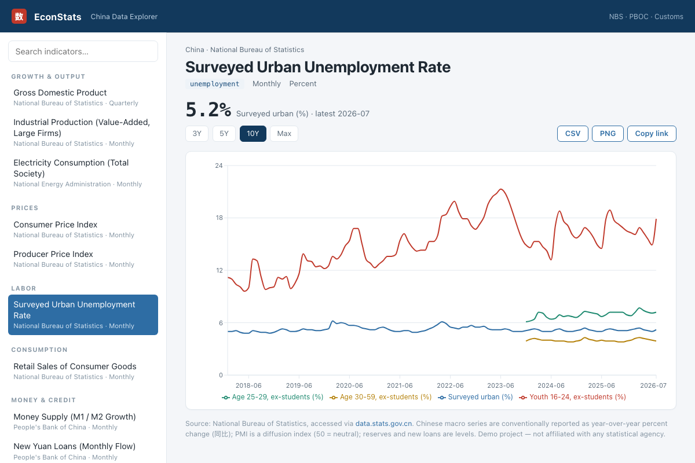

# China Data Explorer

A FRED-style web app for browsing Chinese macroeconomic data. Built entirely on
open-source tooling already in this project — **Bun** (server + bundler),
**React 19** (UI), **Recharts** (charts) — nothing from scratch.

The broader product target and remaining parity work are tracked in
[`FRED_PARITY.md`](./FRED_PARITY.md).



## Run it

From the project root:

```sh
bun run china-explorer/server/app.ts
# then open http://localhost:5173   (set PORT=xxxx to change)
```

## How it works

```
browser ──> Bun.serve ──> local NBS catalog       (tens of thousands of searchable series)
                     ├──> NBS esData portal       (observations and regional dimensions)
                     ├──> Eastmoney datacenter    (featured macro series)
                     └──> AKTools (AkShare)        (LPR, Caixin PMI ×2, electricity — optional; see below)
```

- **`server.ts`** — Bun.serve serves the page (bundling `client/app.tsx` on the
  fly) and exposes catalog search, dataset facets, regional dimensions,
  releases, revisions, and series observations as JSON routes.
- **`server/nbs-catalog.ts`** — loads the generated NBS catalog, searches it, resolves
  geographic dimensions, retrieves observations, and applies transformations.
- **`server/data.ts`** — the featured macro catalog plus three source fetchers
  (Eastmoney, NBS, AKTools) and a 1-hour in-memory cache. All fetching
  is server-side, which is how FRED works and avoids the browser CORS wall
  (Eastmoney/NBS send no CORS headers).
- **`client/app.tsx`** — responsive FRED-style workspace with global search,
  dataset/frequency/geography filters, comparisons, transformations, region
  selection, charts, tables, metadata, saved series, exports, and releases.

## Build the full NBS catalog

The checked-in snapshot is produced from the official portal's live hierarchy,
not a hand-maintained series list:

```sh
bun run china:catalog
```

The sync walks all ten current dataset families: national monthly, quarterly,
and annual; provincial monthly, quarterly, and annual; major-city monthly and
annual; and Hong Kong/Macao/Taiwan monthly and annual. It publishes an atomic
snapshot after each completed dataset root and keeps in-progress work in a
`.partial` checkpoint. Use
`--codes=1,5`, `--delay=750`, or `--concurrency=3` to tune a refresh.
When refreshing only selected families, pass `--merge=true` to retain the
families already present in the published snapshot.

## FRED-style features

- **Deep links** — every series has its own URL (`#/series/cpi`), so views can
  be bookmarked or shared; comma-separated keys create comparison views.
- **Catalog discovery** — full-text search across titles, categories, dataset
  names, and IDs, with frequency and geography facets.
- **Series tools** — raw levels, changes, percent changes, year-over-year
  changes, index-to-growth conversion, log scale, ranges, tables, and metadata.
- **Regional dimensions** — applicable NBS series expose province or city
  selectors loaded from the official data catalog.
- **Saved series and releases** — favorites persist locally and the Releases
  view uses the current official NBS publication schedule.
- **CSV and JSON export** — downloads the observations behind the current view.
- **PNG export** — renders the chart to a titled, 2x-resolution image with
  agency/frequency/unit and a source line baked in, ready to paste into a doc.

## Local JSON API

- `GET /api/catalog/stats` — coverage and dataset/category facets.
- `GET /api/search?q=&frequency=&geography=&dataset=&category=&limit=&offset=`
  — paginated catalog search.
- `GET /api/dimensions/:key` — valid geographic selections for an NBS series.
- `GET /api/series/:key?region=&transform=&limit=` — observations and metadata.
- `GET /api/releases?start=&end=` — the NBS publication calendar.
- `GET /api/revisions/:key?label=&period=` — locally stored revision history.

## Optional: AKTools (AkShare) for extra breadth

Four indicators — **LPR** (interest rates), **Caixin Manufacturing/Services PMI**,
and **Electricity Consumption** — are pulled from [AkShare](https://github.com/akfamily/akshare)
via its HTTP wrapper [AKTools](https://github.com/akfamily/aktools). AkShare
maintains *hundreds* of `macro_china_*` series, so this is how the explorer
grows beyond what we hand-wire. To enable them, run AKTools alongside the app:

```sh
python -m venv venv && source venv/bin/activate
pip install aktools
python -m aktools            # serves http://127.0.0.1:8080  (override with AKTOOLS_URL)
```

Without AKTools running, the other 12 indicators still work; the AkShare-backed
ones just error until it's up. Adding more AkShare series is a one-entry change
in `server/data.ts` (function name, date format, and which fields to plot).

## Notes

- Sources: mostly Eastmoney (mirrors NBS/PBOC/Customs), NBS-direct for
  unemployment, and AkShare for the four extras above. Attribute to the
  originating agency, not the aggregator.
- Chinese conventions are respected: YoY % for most series, PMI as a diffusion
  index (50 = neutral), reserves/new-loans as levels.
- Freshness varies: Eastmoney/NBS/LPR/electricity are current; the Caixin
  "report" series come via a vendor feed that lags ~1–2 months.
- Demo project — not affiliated with any statistical agency.
- **Provincial GDP** is also retained as a curated shortcut. Full-catalog NBS
  regional series expose their available geographic selector dynamically.

## Capture regional NBS IDs

The regional IDs were obtained from the portal's own live request. Re-run the
capture against any province with Chrome installed:

```sh
bun run china-explorer/scripts/capture-area.ts --province=广东省
```

The script writes the complete matching `esData` request and response under
`china-explorer/captures/`. Use `--out=path/to/file.json`, `--headed=true`, or
`--channel=chromium` to override its defaults.

## Deploying

The explorer runs from one process and two SQLite files. `Dockerfile.china`
at the repository root builds it alone:

```sh
docker build -f Dockerfile.china -t econstats-china .
docker run -p 5173:5173 -v china-data:/data econstats-china
```

- `/data/china.db` is the store — observations, revisions, fetch log. Mount a
  persistent volume; it is the only state that matters. Seed it by running
  `bun run china-explorer/server/ingest.ts` inside the container, and schedule
  the same command daily (a Railway cron, a systemd timer, anything).
- `/data/catalog.db` is a cache rebuilt from `china-explorer/catalog/*.json`
  whenever those files change. Losing it costs half a second.
- `GET /health` returns `{ ok: true, observations, lastFetch }` for a platform
  healthcheck (`railway.toml` already points at `/health`).
- `ANTHROPIC_API_KEY` is optional: without it, search still works but English
  queries that miss are not expanded.
- Set `AKTOOLS_URL=off` on a deployment without AKTools so those refreshes are
  skipped with a clear message instead of probing localhost.
- The five AkShare-backed series need AKTools (`python -m aktools` on :8080,
  `AKTOOLS_URL` to point elsewhere). Without it they serve from the store and
  their refresh is logged as a failure rather than breaking anything.

### Railway, specifically

Live: https://econstats-china-production.up.railway.app (project
`econstats-china` in the EconStats workspace; redeploy with `railway up --detach`
from the repository root, where the CLI is linked to it).

1. `railway login`, then in this repository `railway init` (new project) or
   `railway link` (existing). Create a service from the GitHub repo, branch
   `china-data-explorer`.
2. In the service settings set **Config file path** to `railway.china.toml`
   (the root `railway.toml` belongs to the agent app). It selects
   `Dockerfile.china` and the `/health` check.
3. Add a **volume** mounted at `/data`. On first boot the store is seeded
   from `china-explorer/seed/china.db` (committed; refresh it with
   `bun run china:seed` after a good ingest), so the site has data before the
   first refresh.
4. Variables: none required. Optional: `ANTHROPIC_API_KEY` (search query
   expansion), `INGEST_EVERY_HOURS` (default 24 in production; the refresh
   runs inside the web process because a volume attaches to one service),
   `AKTOOLS_URL` if you run AKTools somewhere reachable.
5. Deploy. Watch the first scheduled ingest in the logs two minutes after
   boot — that is the moment you learn whether NBS answers Railway's IPs.

Unverified: whether the NBS portal answers requests from cloud IP ranges. All
testing so far was from a residential US connection. Check the fetch log after
the first scheduled ingest.
